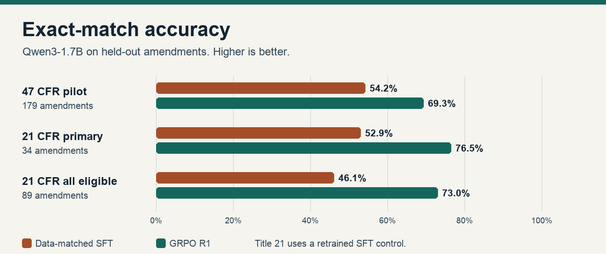
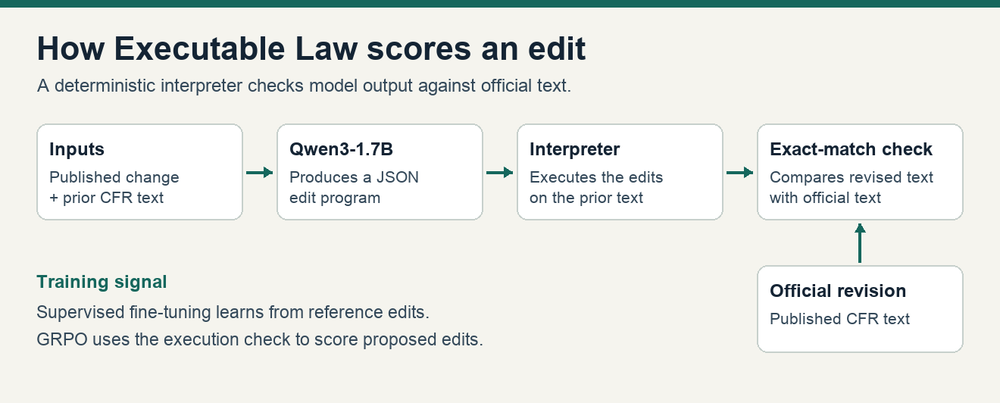

<p align="center">
  
</p>

<h1 align="center">Executable Law</h1>

<p align="center">
  <b>Teaching a small model to apply U.S. regulatory amendments, with rewards checked by execution.</b><br>
  Qwen3-1.7B &middot; LoRA SFT + GRPO &middot; exact-match reward against the official eCFR text
</p>

---

A Federal Register final rule says things like *"Amend § 5.71 by adding paragraph (d) to read as follows."*
Executable Law turns each such instruction, together with the current text of the CFR section, into a short **edit
program**. Running the program must reproduce the official amended eCFR text **exactly**. The interpreter computes the exact-match score by comparing the resulting text with the official revision.

```json
[{"op": "insert_after", "p": 4,
  "text": ["(d) Spectrum Horizons experimental radio license. Licenses are issued for a term of 10 years and may not be renewed."]}]
```

The language has four operations (`replace`, `set`, `delete`, `insert_after`) over numbered paragraphs, and the
model also states its confidence that the edit is exactly right.

## Evidence

<p align="center">
  
</p>

**Title 47 (FCC), trained on 2017–2023 rules, tested on 179 amendments effective 2024–2025:**

| Model | Exact match | 95% CI |
|---|---:|---|
| Qwen3-1.7B, 3-shot | 5.6% | 3.1–10.0 |
| Qwen3-8B, 3-shot | 33.5% | 27.0–40.7 |
| Qwen3-14B, 3-shot | 46.4% | 39.2–53.7 |
| 1.7B LoRA SFT (463 examples) | 49.2% | 41.9–56.4 |
| 1.7B SFT on SFT + RL pool (772 examples, data-matched control) | 54.2% | 46.9–61.3 |
| **1.7B SFT + GRPO, exact-match reward (R1)** | **69.3%** | **62.2–75.6** |
| 1.7B SFT + GRPO, R1 + Brier/abstention (R3) | 60.9% | 53.6–67.7 |

- GRPO R1 beats SFT by **+20.1 points** (paired bootstrap +13.4 to +27.4; 42 items fixed, 6 broken) and the
  data-matched SFT control by **+15.1** (+8.4 to +21.8), and beats few-shot Qwen3-14B by +22.9.
- On the 91 items effective in 2025, which are less likely to be in the base model's pretraining data, the
  ordering holds (R1 64.8% vs SFT 44.0%).

### Transfer to Title 21 food and drug rules

Neither model trained on Title 21. The supervised control was retrained from the original Title 47 data and settings.

| Set | Items (rules) | GRPO R1 | Data-matched control | Delta | Rule-cluster 95% |
|---|---|---:|---:|---:|---|
| Primary | 34 (17) | 76.5% | 52.9% | +23.5 | +8.1 to +37.9 |
| Incl. formulaic parts 500–599 | 89 (28) | 73.0% | 46.1% | +27.0 | +17.1 to +36.2 |

The whole Title 47 pilot used 3.8 GPU-hours on one NVIDIA L40S. Full tables, the alignment funnel, calibration
results, pre-specified criteria (including the ones not met) and caveats are in [docs/RESULTS.md](docs/RESULTS.md).

## How it works

<p align="center">
  
</p>

1. **Align.** `src/build_data.py` pulls final rules (Federal Register API) and point-in-time section text on the day
   before and the day of each effective date (eCFR versioner API). An example is kept only if the instruction text
   attests the change and a derived reference program reproduces the official text exactly (1,452 of 3,448
   section instructions for Title 47; 951 after filters).
2. **Split by time.** `src/make_splits.py`: SFT 463 and RL pool 309 (2017–2023), test 179 (2024–2025).
3. **SFT.** `src/sft.py`: LoRA (r 64) with completion-only loss on the reference programs.
4. **GRPO.** `src/grpo.py`: TRL GRPO with vLLM colocated, 8 prompts × 8 samples per step, on the 175 RL prompts
   the SFT model solves sometimes but not always. Reward R1 is 1 for an exact match, −0.5 for a wrong program and
   −1 for an invalid one (`src/scoring.py`).
5. **Score.** `src/infer.py` decodes greedily and executes each program; `src/report.py` and
   `tools/paired_metrics.py` give Wilson intervals, ECE, paired item and rule-cluster bootstraps and McNemar tests.

## Reproduce

### Verify the released results on a CPU (about a minute, no GPU or network)

```bash
python -m pip install -r requirements-cpu.txt     # lxml, imported by the interpreter module

# code hashes, frozen inputs, all 1,219 reference programs, and re-scoring of all 2,765 stored model outputs
python tools/verify_cpu.py

# recompute every Title 47 number and check it against results/REPORT.json and the stored summaries
python tools/paired_metrics.py --res results --data data/splits/test.jsonl --check-report results/REPORT.json

# Title 21: primary and sensitivity sets against the stored reports
python tools/paired_metrics.py --res results/title21 --data heldout/t21/heldout.jsonl --check-report results/title21/heldout-report.json
python tools/paired_metrics.py --res results/title21 --data heldout/t21/heldout_all.jsonl --check-report results/title21/heldout_all-report.json
```

Each command ends with `ALL CHECKS PASSED` or `all recomputed summary and paired values match the stored files`.
`paired_metrics.py` needs only the Python standard library (3.9+).

### Retrain and re-evaluate on one GPU

Linux, Python 3.12, one CUDA GPU with 48 GB (the runs used an NVIDIA L40S).

```bash
python -m pip install -r requirements-gpu.txt
bash tools/run_pilot.sh all          # baselines sft prefilter grpo_R1 grpo_R3 sft_all report
```

Outputs go to `runs/pilot/{models,results,logs}` (`OUT=` to change). Stages can be run one at a time, for example
`bash tools/run_pilot.sh sft prefilter grpo_R1`. GRPO stops on a wall clock (`MINUTES=50`, as in the pilot), so
step counts depend on the GPU. One seed was run, and the retrained data-matched control landed 2.2 points from the
original, so expect run-to-run differences of a few points.

To compare a rerun with the released predictions item by item:

```bash
python tools/paired_metrics.py --compare results/test_sft.jsonl runs/pilot/results/test_sft.jsonl
```

The Title 21 runner, `tools/run_matched_title21.sh`, takes an SFT adapter, a GRPO R1 adapter, and a data-matched control. Set `PREFLIGHT_ONLY=1` to check the inputs on CPU. The original adapter hashes are in [PROVENANCE.md](PROVENANCE.md).

### Rebuild the dataset (network)

```bash
MIN_INTERVAL=0.35 python src/build_data.py --titles 47 --out build --workers 1   # the eCFR API throttles bursty clients
python src/make_splits.py --in build/examples.jsonl --out build/splits
```

The live APIs can return newer versions than in November 2026; `data/splits/` is the reference.

## Repository

| Path | Contents |
|---|---|
| `src/` | Exact code that ran: parsing and the edit-program interpreter (`el_core.py`), data build and splits, prompt (`prompts.py`), scorer and rewards (`scoring.py`), inference, SFT, GRPO, report |
| `tools/` | CPU verification, metric recomputation, pilot runner, SFT-merge rebuild, Title 21 runner |
| `data/splits/` | Title 47 SFT, RL, GRPO-prompt, test and few-shot splits, alignment funnel and split statistics |
| `heldout/t21/` | Frozen Title 21 sets with manifest and overlap audit |
| `results/` | Per-item predictions, summaries and `REPORT.json` for every Title 47 model; `training/` step logs and GRPO rewards; `title21/` transfer predictions, reports and provenance |
| `configs/` | Exact commands, trainer arguments, LoRA configs, decoding settings, environment and code hashes |
| `docs/RESULTS.md` | Full results and caveats |
| `PROVENANCE.md` | What ran where, what is and is not included, adapter hashes |

## Limitations

One CFR title for training, one seed, and 179 Title 47 test items (intervals of about ±7 points); the Title 21 primary
set has 34 items. GRPO stopped after about 70 of 120 planned steps and used no KL penalty. R3 did not improve
calibration, because the SFT model almost always states confidence 1.0. Alignment covers 42% of parsed instructions,
with effective-date mismatches the largest loss. Model weights are not part of this repository.
